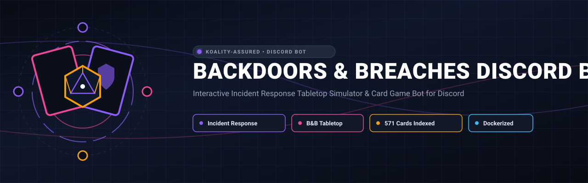
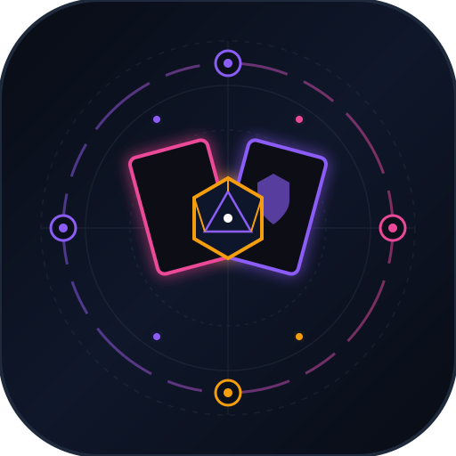

<div align="center">



# Backdoors & Breaches Discord Bot

<p align="center">
  
</p>

**Interactive Incident Response Tabletop Simulator & Card Game Bot for Discord**

[](https://github.com/Koality-Assured/backdoors-and-breaches-bot/actions/workflows/ci.yml)
[](https://github.com/Koality-Assured/backdoors-and-breaches-bot/actions/workflows/docker.yml)
[](LICENSE)
[](https://www.blackhillsinfosec.com/projects/backdoors-breaches/)
[](pyproject.toml)
[]()
[](https://conventionalcommits.org)

</div>

---

A modern, production-grade Discord bot for **Backdoors & Breaches (B&B)**, the premier incident response tabletop card game created by [Black Hills Information Security (BHIS)](https://www.blackhillsinfosec.com).

Simulate security breaches, run tabletop exercises (TTX), train SOC analysts, and test blue team detection procedures directly within Discord using interactive buttons, menus, d20 dice rolls, and high-resolution card artwork.

---

## Highlights
- 🎮 **Interactive Tabletop Simulator:** Host full incident response exercises directly in Discord. An Incident Master facilitates while defenders join, hold private hands of procedure cards, roll d20s, and uncover attack vectors.
- 🎲 **Tabletop Facilitator Tools:** Running a tabletop exercise in voice chat or in person? Instantly deal 4 secret attack vectors, roll custom dice, or pull random injects and consultants on demand.
- 🃏 **10 Official Expansions & 571 Cards:** Ships with 571 indexed cards and high-resolution artwork across Core decks, Cloud Security, ICS-OT, Red Canary, Huntress, Trimarc, and DenSecure.
- ⚡ **Modern Discord UI Components:** Built on `discord.py` 2.x using interactive Buttons, Dropdown Select Menus, Ephemeral Hand Views, and Card Browsing Paging.
- 🔍 **Card Encyclopedia & Autocomplete:** Search cards by name or keyword with real-time slash command autocomplete.
- 🐳 **Production-Ready & Hardened:** Runs as an unprivileged user inside a slim Docker container with Docker Compose support and GitHub Actions CI.
---
## Supported Decks & Expansions
All 10 decks are included and verified with 100% asset resolution:
| Expansion Deck | Deck Slug | Cards | Description |
|---|---|---|---|
| **Core V2.2** *(Default)* | `CoreV2.2` | 52 | Standard base deck with contemporary attack vectors & blue team procedures |
| **Core V2.2 Expansion** | `CoreV2.2-Expansion` | 40 | Consultant cards, advanced procedures, and expansion attack vectors |
| **Cloud Security** | `CloudSecurity` | 34 | AWS, Azure, GCP attack chains, IAM compromises, and cloud forensics |
| **ICS-OT** | `ICS-OT` | 52 | Industrial Control Systems & Operational Technology scenarios (Dragos collaboration) |
| **Huntress Expansion** | `Huntress` | 85 | Managed detection, persistence hunting, and MSP threat scenarios |
| **Trimarc Expansion** | `Trimarc` | 86 | Active Directory security, Kerberos abuse, and enterprise identity defense |
| **DenSecure** | `DenSecure` | 85 | Red team and penetration testing tradecraft scenarios |
| **Red Canary** | `RedCanary` | 33 | Threat detection, adversary intelligence, and endpoint telemetry |
| **Core V2.1** | `CoreV2.1` | 52 | Revision 2.1 core tabletop deck |
| **Core V1** | `CoreV1` | 52 | Original first edition Backdoors & Breaches card set |
---
## Quickstart
### Option 1: Docker (Recommended)
1. **Clone the repository:**
   ```bash
   git clone https://github.com/Koality-Assured/backdoors-and-breaches-bot.git
   cd backdoors-and-breaches-bot
   ```
2. **Configure your bot token:**
   ```bash
   cp .env.example .env
   ```
   Open `.env` in an editor and set your `DISCORD_TOKEN`:
   ```env
   DISCORD_TOKEN=your_discord_bot_token_here
   DEFAULT_DECK=CoreV2.2
   ```
3. **Start the bot:**
   ```bash
   docker compose up -d
   ```
### Option 2: Python (Local Virtual Environment)
1. **Clone and install dependencies:**
   ```bash
   git clone https://github.com/Koality-Assured/backdoors-and-breaches-bot.git
   cd backdoors-and-breaches-bot
   python -m venv .venv
   source .venv/bin/activate  # On Windows: .venv\Scripts\activate
   pip install -r requirements.txt
   ```
2. **Configure environment:**
   ```bash
   cp .env.example .env
   # Edit .env with your DISCORD_TOKEN
   ```
3. **Run the bot:**
   ```bash
   python main.py
   ```
---
## Discord Developer Portal Setup
1. Navigate to the [Discord Developer Portal](https://discord.com/developers/applications).
2. Click **New Application** and give your bot a name (e.g. `Backdoors & Breaches`).
3. Under the **Bot** tab:
   - Click **Reset Token** and copy your token to `.env` as `DISCORD_TOKEN`.
   - Under **Privileged Gateway Intents**, enable:
     - **Message Content Intent** (Required for prefix commands)
4. Under the **OAuth2** -> **URL Generator** tab:
   - Select scopes: `bot`, `applications.commands`
   - Select bot permissions:
     - `Send Messages`
     - `Embed Links`
     - `Attach Files`
     - `Read Message History`
     - `Use Application Commands`
5. Open the generated invite URL in your browser to add the bot to your server.
---
## Command Reference
### Interactive Game Commands (`/game ...`)
| Command | Description |
|---|---|
| `/game setup [deck]` | Create an incident response exercise lobby in the channel. You become Incident Master. |
| `/game join` | Join the active lobby as a defender. |
| `/game start` | Incident Master starts the exercise. 4 attack vectors are dealt secretly and hands are distributed. |
| `/game play <card> [target]` | Play a procedure card and roll a d20 to investigate/mitigate an attack vector. |
| `/game hand` | View your secret hand of procedure cards (+3 roll bonus) via an ephemeral message. |
| `/game status` | Display the status of the incident, active cooldowns, round count, and uncovered vectors. |
| `/game im-panel` | Private Incident Master controls (view secret vectors, trigger manual injects, end exercise). |
| `/game pass` | Pass your turn to the next defender. |
| `/game end` | Conclude the current exercise session. |
### Facilitator & Tabletop Tools
| Command | Description |
|---|---|
| `/scenario [deck]` | Privately deals 4 secret attack vectors (Initial, Pivot, Persist, C2) for running live exercises. |
| `/roll [sides] [modifier]` | Roll dice (d20, d6, etc.) with visual result breakdowns. |
| `/inject [deck]` | Draw a random Inject complication card with artwork and details. |
| `/consultant [deck]` | Draw a random Consultant expert card. |
### Card Encyclopedia & Information
| Command | Description |
|---|---|
| `/card <name>` | Look up any card with full artwork, type badge, and documentation links. (Autocomplete enabled) |
| `/search <query> [deck]` | Search cards by keyword across all 10 expansions with interactive pagination. |
| `/dump <card_type> [deck]` | Browse cards of a specific type (e.g. procedure, inject, consultant) with paging buttons. |
| `/decks` | List all 10 expansions, card counts, and release revisions. |
| `/bnbrules` | Quick reference guide on Backdoors & Breaches tabletop mechanics. |
| `/bnbhelp` | Display comprehensive command guide. |
| `/ping` | Check bot latency, uptime, and loaded card statistics. |
---
## How Backdoors & Breaches Works
Backdoors & Breaches teaches cybersecurity incident handling fundamentals through simulated scenarios.
### The 4 Attack Vectors (The Kill Chain)
1. 🎯 **Initial Compromise:** How the adversary initially broke into the perimeter (e.g., Phishing, Exploit Public Facing App, Supply Chain).
2. 🔀 **Pivot & Escalate:** Lateral movement and privilege escalation (e.g., Mimikatz, Kerberoasting, Local Admin Password Reuse).
3. ⚓ **Persistence:** How the adversary maintains access across reboots (e.g., Scheduled Tasks, Web Shell, Registry Run Keys).
4. 📡 **C2 & Exfiltration:** Command & Control channels and data exfiltration (e.g., DNS Tunneling, HTTPS as Exfil, Cobalt Strike).
### Game Rules & Mechanics
- **Turn Flow:** Defenders take turns playing **Procedure Cards** (e.g., SIEM Log Analysis, Endpoint Analysis, Network Threat Hunting).
- **d20 Rolls:** Defenders roll a 20-sided die.
  - **Success (Total >= 11):** If the procedure successfully targets an attack vector, that vector is uncovered!
  - **Failure (Total < 11):** The procedure card is placed on **cooldown for 2 turns**, and the failure streak increments.
- **Hand Bonus:** Playing a card from your personal hand grants a **+3 bonus** to your d20 roll!
- **Natural 20 (Critical Success):** Automatically succeeds and uncovers an attack vector.
- **Natural 1 (Critical Failure):** Immediately triggers an **Inject** card and places the procedure on cooldown.
- **Inject Triggers:** Accumulating **3 consecutive failed rolls** automatically triggers an **Inject** card (e.g., "Bobby the Intern kills the server", "Data uploaded to Pastebin").
- **Win Condition:** Defenders win if all **4 attack vectors** are uncovered before the round limit (default: 10 rounds).
---
## Development & Testing
### Running Tests
The test suite validates data schemas, deck asset resolution across all 571 cards, game state transitions, and configuration loading:
```bash
# Run unit tests
pytest
# Verify all card assets and images across 10 expansions
python scripts/verify_decks.py
# Lint codebase
ruff check .
```
### Project Structure
```
backdoors-and-breaches-bot/
├── bnb/
│   ├── cogs/
│   │   ├── admin_cog.py       # Help, rules, ping, about, sync
│   │   ├── assistant_cog.py   # Tabletop facilitator tools (/scenario, /roll, /inject)
│   │   ├── cards_cog.py       # Card encyclopedia, search, autocomplete, deck lists
│   │   └── game_cog.py        # Full interactive game engine commands (/game ...)
│   ├── ui/
│   │   ├── embeds.py          # Rich Discord embed formatters
│   │   └── views.py           # Interactive Buttons, Selects, and Paging Views
│   ├── config.py              # Environment and settings manager
│   ├── deck_loader.py         # Multi-tier asset indexer and image resolver
│   ├── engine.py              # Pure-logic game engine & multi-channel state manager
│   └── models.py              # Card, Deck, Player, ThreatSlot, PlayResult data models
├── decks/                     # 10 card expansions & asset images
├── scripts/
│   └── verify_decks.py        # Card asset and image verification utility
├── tests/                     # Comprehensive pytest test suite
├── Dockerfile                 # Hardened multi-stage container build
├── docker-compose.yml         # Container deployment configuration
├── .github/workflows/         # CI testing and GHCR publishing workflows
├── pyproject.toml             # Modern Python project configuration
├── requirements.txt           # Pinned dependencies
├── LICENSE                    # MIT License with BHIS attributions
└── README.md                  # This documentation
```
---
## License & Attribution
- **Software License:** MIT License — Copyright (c) 2026 [Koality Assured](https://github.com/Koality-Assured) & Contributors.
- **Game Attribution:** Backdoors & Breaches is designed and created by [Black Hills Information Security (BHIS)](https://www.blackhillsinfosec.com) and is released under the **Creative Commons Attribution-ShareAlike 4.0 International (CC BY-SA 4.0)** license.
- *Notice: This repository is an independent open-source community bot and is not officially affiliated with or endorsed by Black Hills Information Security.*
