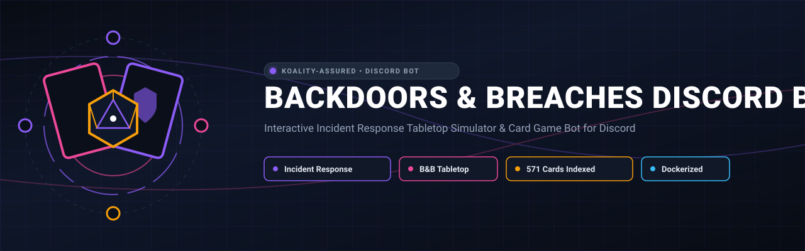
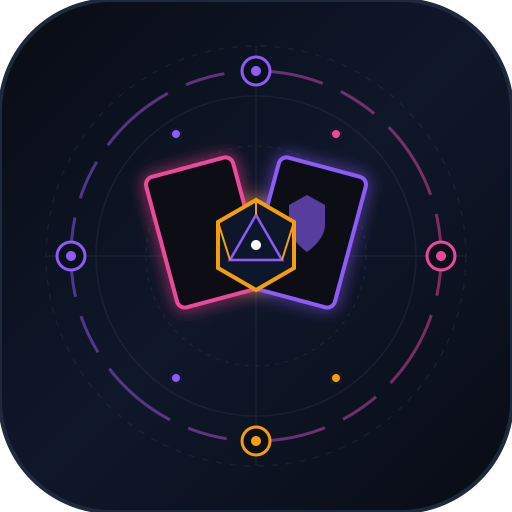
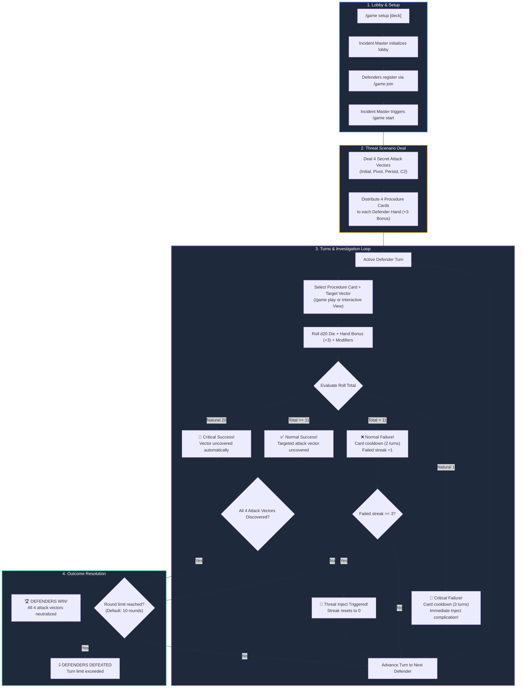

<div align="center">



# Backdoors & Breaches Discord Bot

<p align="center">
  
</p>

**Interactive Incident Response Tabletop Simulator & Card Game Bot for Discord**

[](LICENSE)
[](pyproject.toml)
[](tests/)
[](https://github.com/astral-sh/ruff)
[](https://github.com/Koality-Assured/backdoors-and-breaches-bot/actions/workflows/ci.yml)
[](https://github.com/Koality-Assured/backdoors-and-breaches-bot/actions/workflows/docker.yml)
[](https://backdoorsandbreaches.com/)
[](#)
[](https://conventionalcommits.org)

</div>

---

A modern, production-grade Discord bot for **Backdoors & Breaches (B&B)**, the premier incident response tabletop card game created by [Black Hills Information Security (BHIS)](https://www.blackhillsinfosec.com).

Simulate security breaches, run tabletop exercises (TTX), train SOC analysts, and test blue team detection procedures directly within Discord using interactive buttons, menus, d20 dice rolls, and high-resolution card artwork.

---

## Highlights

- 🎮 **Interactive Tabletop Simulator:** Host full incident response exercises directly in Discord. An Incident Master facilitates while defenders join, hold private hands of procedure cards, roll d20s, and uncover attack vectors.
- 🎲 **Tabletop Facilitator Tools:** Running a tabletop exercise in voice chat or in person? Instantly deal 4 secret attack vectors, roll custom dice, or pull random injects and consultants on demand.
- 🃏 **10 Official Expansions & 571 Cards:** Ships with 571 indexed cards and high-resolution artwork across Core decks, Cloud Security, ICS-OT, Red Canary, Huntress, Trimarc, and DenSecure.
- ⚡ **Modern Discord UI Components:** Built on `discord.py` 2.x using interactive Buttons, Dropdown Select Menus, Ephemeral Hand Views, and Card Browsing Paging.
- 🔍 **Card Encyclopedia & Autocomplete:** Search cards by name or keyword with real-time slash command autocomplete.
- 🛡️ **Zero-Trust Hardened Architecture:** Pure-logic state machine decoupled from Discord I/O, non-root Docker runtime, and automated adversarial security auditing.

---

## Game Loop Architecture

The diagram below illustrates the complete lifecycle of a Backdoors & Breaches exercise, from lobby formation and secret scenario generation to turns, dice evaluations, critical outcomes, and victory resolution:



---

## Clean System Architecture

The codebase follows a strict separation of concerns, ensuring pure game mechanics are fully decoupled from Discord API transports:

```mermaid
flowchart LR
    subgraph Discord["Discord Platform Layer"]
        CLI["Slash & Prefix Commands"]
        UI["Buttons, Selects & Ephemeral Views"]
    end

    subgraph Cogs["Modular Application Cogs"]
        GC["GameCog<br/>(/game ...)"]
        AC["AssistantCog<br/>(/scenario, /roll, /inject)"]
        CC["CardsCog<br/>(/card, /search, /dump, /types)"]
        AD["AdminCog<br/>(/bnbhelp, /bnbrules, /ping)"]
    end

    subgraph Core["Pure-Logic Game Engine"]
        GM["GameManager<br/>(Multi-channel Session Router)"]
        BG["BnbGame<br/>(FSM & Turn Resolution)"]
        MD["Models<br/>(Card, ThreatSlot, Player, Result)"]
    end

    subgraph Storage["Asset & Deck Subsystem"]
        DL["DeckLoader<br/>(Multi-tier Image Resolver)"]
        DK["10 Official Decks<br/>(571 Cards, 427 Images)"]
    end

    Discord <--> Cogs
    Cogs --> Core
    Core --> Storage

    style Discord fill:#1e293b,stroke:#5865F2,color:#fff
    style Cogs fill:#1e293b,stroke:#3b82f6,color:#fff
    style Core fill:#1e293b,stroke:#10b981,color:#fff
    style Storage fill:#1e293b,stroke:#f59e0b,color:#fff
```



- **`bnb/engine.py`**: State machine managing turn progression, cooldown tracking, streak threshold evaluation, and victory/defeat rules. Completely decoupled from Discord I/O for instant, deterministic testing.
- **`bnb/models.py`**: Typed dataclasses and enums (`Card`, `Deck`, `Player`, `ThreatSlot`, `CardType`, `GamePhase`, `PlayResult`).
- **`bnb/deck_loader.py`**: Multi-tier image resolution engine with case-insensitive fallback indexes, resolving card art across core and expansion sets.
- **`bnb/ui/`**: Reusable Discord component views (`views.py`) and rich embed formatters (`embeds.py`).
- **`bnb/cogs/`**: Discord cog controllers exposing slash commands and traditional prefix commands with full autocomplete support.

---

## Supported Decks & Expansions

All 10 official decks are bundled and verified with 100% asset resolution on disk:

| Expansion Deck | Deck Slug | Cards | Category Breakdown | Description |
|---|---|---|---|---|
| **Core V2.2** *(Default)* | `CoreV2.2` | 52 | Initial: 10, Pivot: 7, Persist: 9, C2: 6, Procedure: 11, Inject: 9 | Standard base deck with contemporary attack vectors & blue team procedures |
| **Core V2.2 Expansion** | `CoreV2.2-Expansion` | 40 | Initial: 3, Pivot: 5, Persist: 5, C2: 1, Procedure: 2, Inject: 10, Consultant: 14 | Consultant cards, advanced procedures, and expansion attack vectors |
| **Cloud Security** | `CloudSecurity` | 34 | Initial: 7, Pivot: 8, Persist: 4, C2: 3, Procedure: 2, Inject: 10 | AWS, Azure, GCP attack chains, IAM compromises, and cloud forensics |
| **ICS-OT** | `ICS-OT` | 52 | Initial: 8, Pivot: 8, Persist: 9, C2: 6, Procedure: 12, Inject: 9 | Industrial Control Systems & Operational Technology scenarios (Dragos collaboration) |
| **Huntress Expansion** | `Huntress` | 85 | Initial: 14, Pivot: 9, Persist: 13, C2: 8, Procedure: 12, Inject: 23, Consultant: 6 | Managed detection, persistence hunting, and MSP threat scenarios |
| **Trimarc Expansion** | `Trimarc` | 86 | Initial: 17, Pivot: 14, Persist: 11, C2: 8, Procedure: 14, Inject: 17, Consultant: 5 | Active Directory security, Kerberos abuse, and enterprise identity defense |
| **DenSecure** | `DenSecure` | 85 | Initial: 17, Pivot: 14, Persist: 14, C2: 10, Procedure: 13, Inject: 17 | Red team and penetration testing tradecraft scenarios |
| **Red Canary** | `RedCanary` | 33 | Initial: 5, Pivot: 7, Persist: 4, C2: 4, Procedure: 2, Inject: 8, Consultant: 3 | Threat detection, adversary intelligence, and endpoint telemetry |
| **Core V2.1** | `CoreV2.1` | 52 | Initial: 10, Pivot: 7, Persist: 9, C2: 6, Procedure: 11, Inject: 9 | Revision 2.1 core tabletop deck |
| **Core V1** | `CoreV1` | 52 | Initial: 10, Pivot: 7, Persist: 9, C2: 6, Procedure: 10, Inject: 10 | Original first edition Backdoors & Breaches card set |

---

## Quickstart

### Option 1: Docker (Recommended)

The bot is packaged as a secure, hardened container running as an unprivileged user (`bnb:10001`):

1. **Clone the repository:**
   ```bash
   git clone https://github.com/Koality-Assured/backdoors-and-breaches-bot.git
   cd backdoors-and-breaches-bot
   ```

2. **Configure your bot environment:**
   ```bash
   cp .env.example .env
   ```
   Edit `.env` to supply your Discord bot token:
   ```env
   DISCORD_TOKEN=your_discord_bot_token_here
   COMMAND_PREFIX=!
   DEFAULT_DECK=CoreV2.2
   MAX_TURNS=10
   INJECT_FAILURE_THRESHOLD=3
   LOG_LEVEL=INFO
   ```

3. **Launch the bot with Docker Compose:**
   ```bash
   docker compose up -d
   ```

4. **Verify container logs and health:**
   ```bash
   docker compose logs -f
   ```

### Option 2: Python (Local Virtual Environment)

1. **Clone and install dependencies:**
   ```bash
   git clone https://github.com/Koality-Assured/backdoors-and-breaches-bot.git
   cd backdoors-and-breaches-bot
   python -m venv .venv
   source .venv/bin/activate  # On Windows: .venv\Scripts\activate
   pip install -r requirements.txt
   ```

2. **Configure environment:**
   ```bash
   cp .env.example .env
   # Set DISCORD_TOKEN in .env
   ```

3. **Start the bot:**
   ```bash
   python main.py
   ```

---

## Discord Developer Portal Setup

1. Navigate to the [Discord Developer Portal](https://discord.com/developers/applications).
2. Click **New Application** and name your bot (e.g., `Backdoors & Breaches`).
3. Under the **Bot** tab:
   - Click **Reset Token** and copy the value to `.env` as `DISCORD_TOKEN`.
   - Under **Privileged Gateway Intents**, enable **Message Content Intent**.
4. Under the **OAuth2** -> **URL Generator** tab:
   - Select scopes: `bot`, `applications.commands`
   - Select bot permissions:
     - `Send Messages`
     - `Embed Links`
     - `Attach Files`
     - `Read Message History`
     - `Use Application Commands`
5. Open the generated invite URL in your browser to authorize the bot on your Discord server.

---

## Command Reference

### Interactive Game Commands (`/game ...`)
| Command | Description |
|---|---|
| `/game setup [deck]` | Create an incident response exercise lobby in the channel. You become Incident Master. |
| `/game join` | Join the active lobby as a defender. |
| `/game start` | Incident Master starts the exercise. 4 attack vectors are dealt secretly and hands are distributed. |
| `/game play <card> [target]` | Play a procedure card and roll a d20 to investigate/mitigate an attack vector. |
| `/game hand` | View your secret hand of procedure cards (+3 roll bonus) via an ephemeral message. |
| `/game status` | Display the status of the incident, active cooldowns, round count, and uncovered vectors. |
| `/game im-panel` | Private Incident Master controls (view secret vectors, trigger manual injects, end exercise). |
| `/game pass` | Pass your turn to the next defender. |
| `/game end` | Conclude the current exercise session. |

### Facilitator & Tabletop Tools
| Command | Description |
|---|---|
| `/scenario [deck]` | Privately deals 4 secret attack vectors (Initial, Pivot, Persist, C2) for running live exercises. |
| `/roll [sides] [modifier]` | Roll dice (d20, d6, etc.) with visual result breakdowns. *(Alias: `!roll-dice`)* |
| `/inject [deck]` | Draw a random Inject complication card with artwork and details. |
| `/consultant [deck]` | Draw a random Consultant expert card. |

### Card Encyclopedia & Information
| Command | Description |
|---|---|
| `/card <name>` | Look up any card with full artwork, type badge, and documentation links. (Autocomplete enabled) |
| `/search <query> [deck]` | Search cards by keyword across all 10 expansions with interactive pagination. |
| `/dump <card_type> [deck]` | Browse cards of a specific type (e.g. procedure, inject, consultant) with paging buttons. *(Alias: `!dump-cards`)* |
| `/types` | Display all 7 core Backdoors & Breaches card types, roles, and rules. *(Alias: `!get-types`)* |
| `/decks` | List all 10 expansions, card counts, and release revisions. |
| `/bnbrules` | Quick reference guide on Backdoors & Breaches tabletop mechanics. *(Alias: `!rules`)* |
| `/bnbhelp` | Display comprehensive command guide. *(Alias: `!tthelp`, `!help`)* |
| `/ping` | Check bot latency, uptime, and loaded card statistics. |
| `/about` | Display project background, licensing, and repository attributions. |

---

## How Backdoors & Breaches Works

Backdoors & Breaches teaches cybersecurity incident handling fundamentals through simulated scenarios.

### The 4 Attack Vectors (The Kill Chain)
1. 🎯 **Initial Compromise:** How the adversary initially broke into the perimeter (e.g., Phishing, Exploit Public Facing App, Supply Chain).
2. 🔀 **Pivot & Escalate:** Lateral movement and privilege escalation (e.g., Mimikatz, Kerberoasting, Local Admin Password Reuse).
3. ⚓ **Persistence:** How the adversary maintains access across reboots (e.g., Scheduled Tasks, Web Shell, Registry Run Keys).
4. 📡 **C2 & Exfiltration:** Command & Control channels and data exfiltration (e.g., DNS Tunneling, HTTPS as Exfil, Cobalt Strike).

### Tabletop Rules & Mechanics
- **Turn Flow:** Defenders take turns playing **Procedure Cards** (e.g., SIEM Log Analysis, Endpoint Analysis, Network Threat Hunting).
- **d20 Rolls:** Defenders roll a 20-sided die.
  - **Success (Total >= 11):** If the procedure successfully targets an attack vector, that vector is uncovered!
  - **Failure (Total < 11):** The procedure card is placed on **cooldown for 2 turns**, and the failure streak increments.
- **Hand Bonus:** Playing a card from your personal hand grants a **+3 bonus** to your d20 roll!
- **Natural 20 (Critical Success):** Automatically succeeds and uncovers an attack vector.
- **Natural 1 (Critical Failure):** Immediately triggers an **Inject** card and places the procedure on cooldown for 3 turns.
- **Inject Triggers:** Accumulating **3 consecutive failed rolls** automatically triggers an **Inject** card (e.g., "Bobby the Intern kills the server", "Data uploaded to Pastebin").
- **Win Condition:** Defenders win if all **4 attack vectors** are uncovered before the round limit (default: 10 rounds).

---

## Adversarial Security & Quality Audit

Following the **Koality Assured Standard**, this repository includes an antagonistic validation suite to guarantee zero credential leakage, zero proprietary identifier exposure, and complete schema integrity:

```bash
python adversarial_review.py
```

The auditor executes 5 strict verification passes:
1. **Zero-Leak Cryptographic Hash Scan:** Hashes every token and word across all files against SHA-256 digests of private identifiers.
2. **Pattern Leak Scan:** Verifies zero local Windows developer paths, user profile paths, secondary drive paths, live Discord bot tokens, AWS keys, or GitHub PATs.
3. **Deck & Asset Integrity:** Verifies 100% asset resolution across all 10 expansions and 571 cards on disk.
4. **Syntax & AST Compilation:** Compiles 100% of Python, JSON, YAML, and TOML files with zero syntax errors.
5. **Pytest Suite Execution:** Runs the unit test suite and enforces a 100% pass rate.

---

## Development & Testing

```bash
# Run unit tests
pytest -v

# Run the full adversarial security audit
python adversarial_review.py

# Verify card asset resolution directly
python scripts/verify_decks.py

# Lint codebase with ruff
ruff check .
```

---

## Community & Contributing

We welcome community contributions, additional deck profiles, and bug reports!

- 🐛 **Bug Reports & Issues:** [GitHub Issues](https://github.com/Koality-Assured/backdoors-and-breaches-bot/issues)
- 💡 **Feature Requests:** [GitHub Discussions](https://github.com/Koality-Assured/backdoors-and-breaches-bot/discussions)
- 📜 **Security Disclosures:** Please review our [Security Policy](SECURITY.md) before reporting vulnerabilities.
- 🤝 **Organization:** [Koality Assured](https://github.com/Koality-Assured)

---

## License & Attribution

- **Software License:** [MIT License](LICENSE) — Copyright © 2026 [Koality Assured](https://github.com/Koality-Assured) & Contributors.
- **Card Game Rules & Concepts:** Backdoors & Breaches is designed and published by [Black Hills Information Security (BHIS)](https://www.blackhillsinfosec.com) and is licensed under the [Creative Commons Attribution-ShareAlike 4.0 International (CC BY-SA 4.0)](https://creativecommons.org/licenses/by-sa/4.0/) license.
- **Disclaimer:** This project is an independent community development and is not officially affiliated with, endorsed by, or sponsored by Black Hills Information Security.

<div align="center">
  <sub>Built with ❤️ by the <strong>Koality Assured</strong> team.</sub>
</div>
